# QMcover

明日方舟 B 站横版封面工坊。首页选模板或空白画布，进编辑器改字、点立绘、换背景、加装饰，导出 **1920×1080 PNG**。

纯前端，草稿存在浏览器 `localStorage`，不接后端。

技术栈：React 19 + Vite + TypeScript + Tailwind CSS 4。

| 空白画布 | 特种三人 | 总攻击 | 模组测评 |
| --- | --- | --- | --- |
| 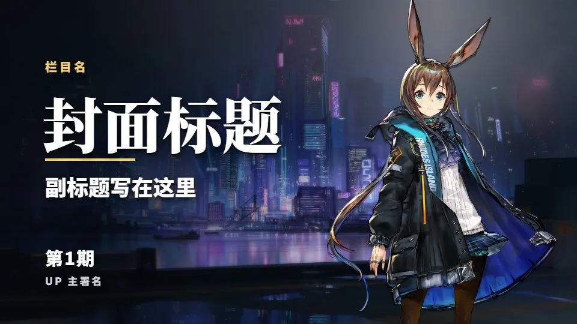 | 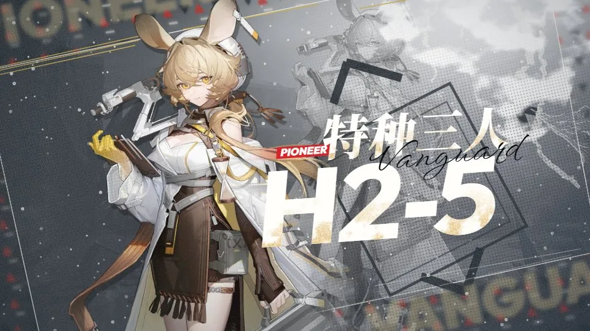 | 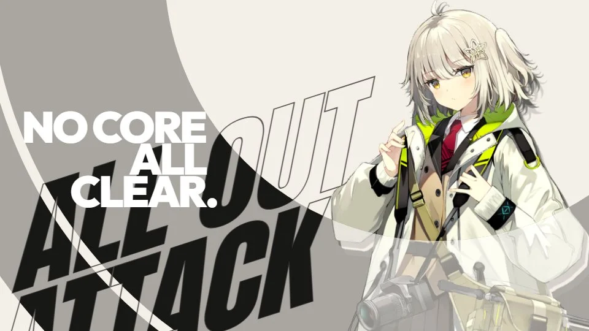 | 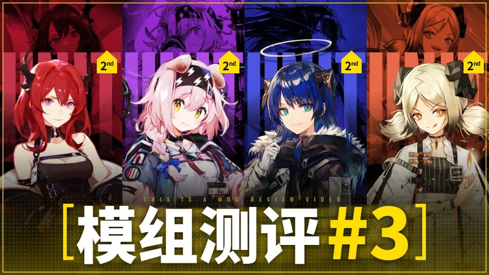 |
| **斜切关卡** | **V我50** | **明日方舟角色测评** | **全息作战矩阵** |
| 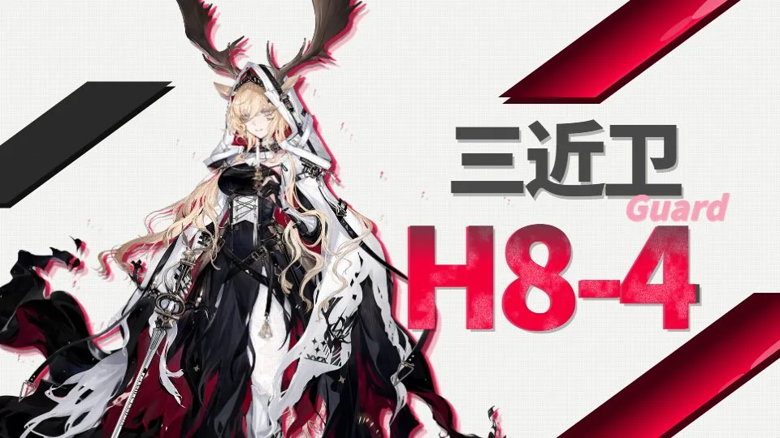 | 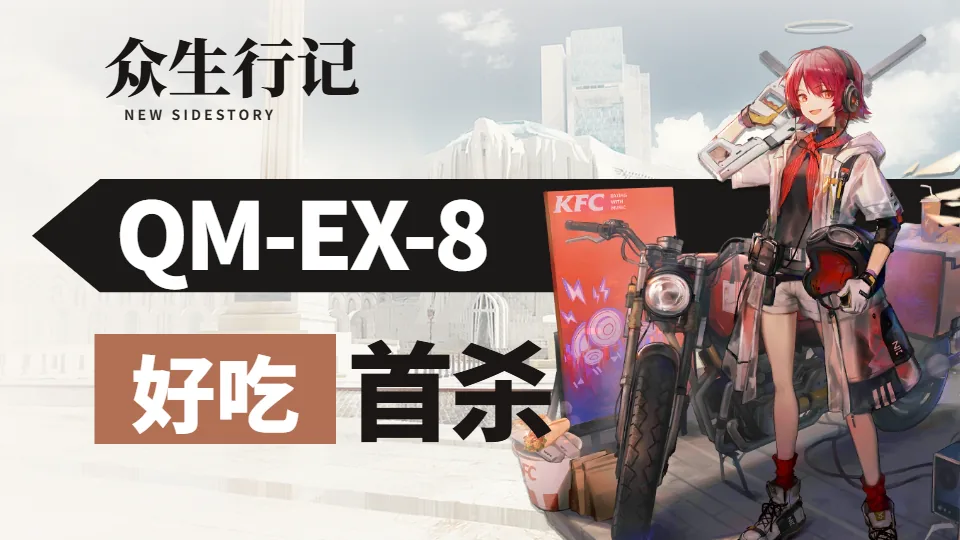 | 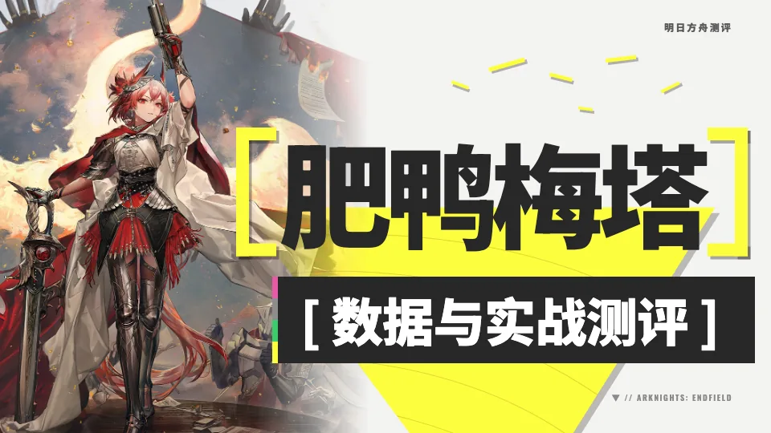 | 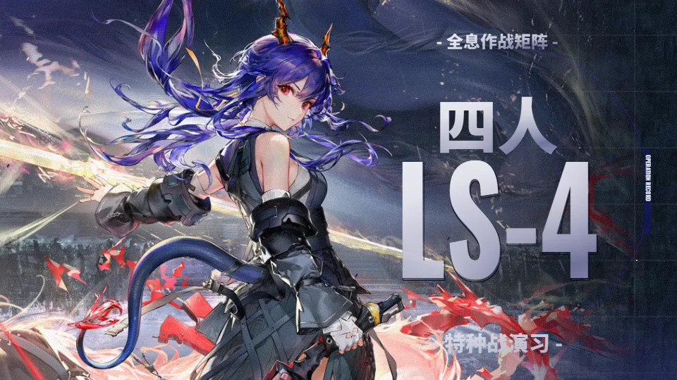 |
| **强度测评** | **危机合约** | **低配攻略** | **肉鸽** |
| 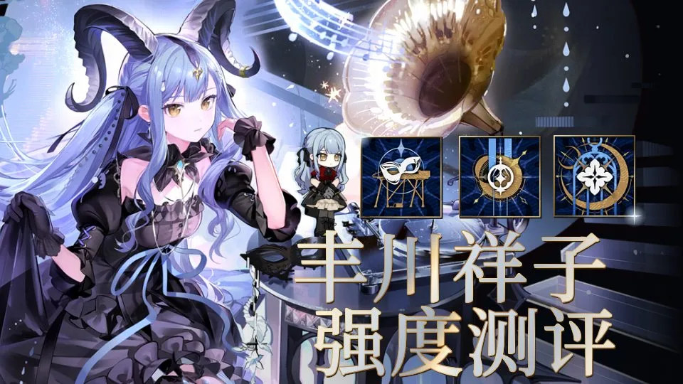 | 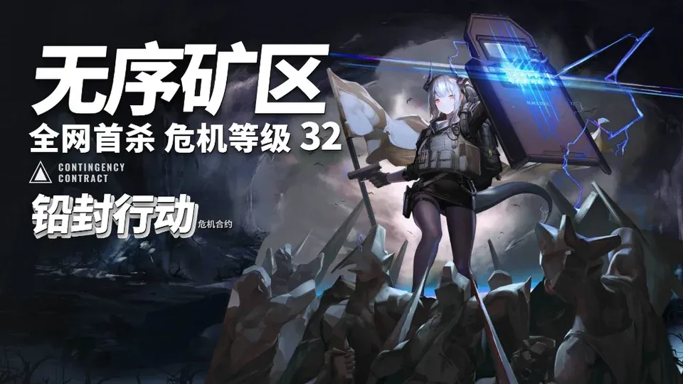 | 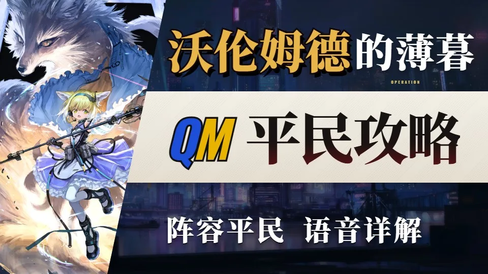 | 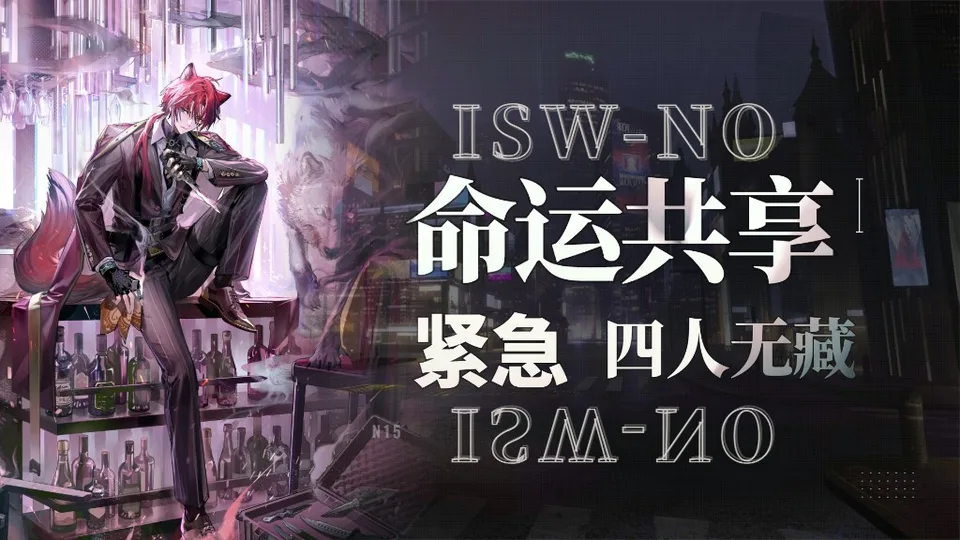 |
| **紧急授课** | **决战五星之癫** | **无核论文** | **职业队** |
| 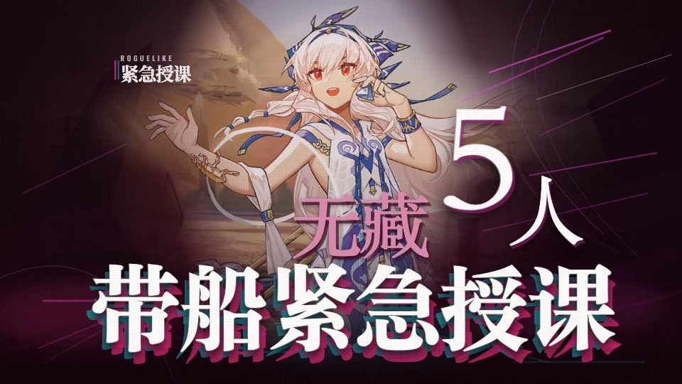 | 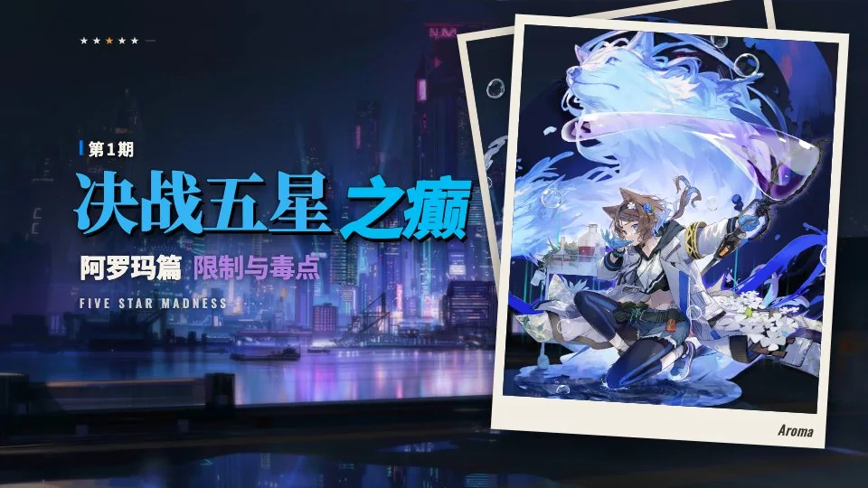 | 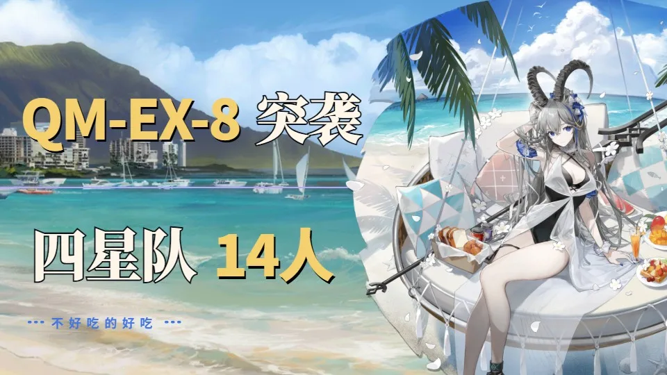 | 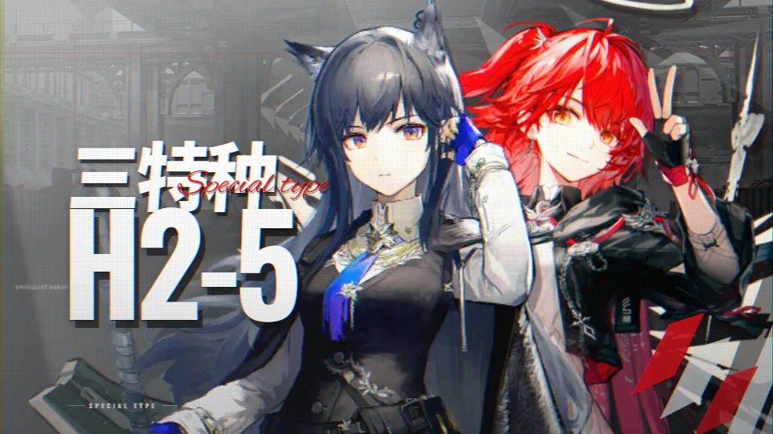 |
| **干员前瞻分析** | **四星无核** | **仅需一人** | |
| 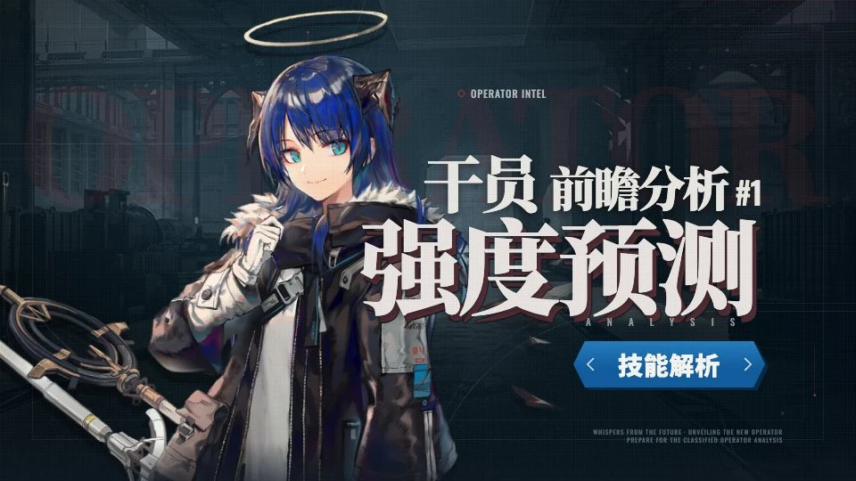 | 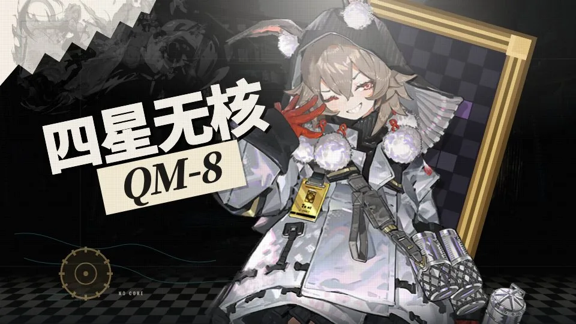 | 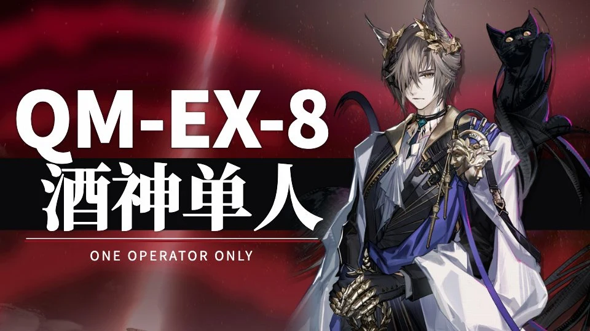 | |

相关文档：

- [如何加模板](TEMPLATES.md)
- [按参考图做新模板](doc/模仿参考图生成模板.md)
- [封面视觉迭代与验收（紧急授课经验）](doc/封面视觉迭代与验收.md)
- [模组测评四列封面做法](doc/模组测评四列封面做法.md)
- 构图参考：[危机合约](references/crisis-contract/INDEX.md) · [肉鸽](references/rogue/INDEX.md) · [紧急授课](references/black-cloak/INDEX.md) · [无核论文](references/kirby/INDEX.md) · [终末地测评](references/endfield-review/INDEX.md) · [莱茵实验组特种队](references/secret-plan/INDEX.md) · [干员前瞻](references/operator-preview/INDEX.md) · [四星无核首杀](references/fourstar-nocore/INDEX.md) · [仅需一人](references/solo-clear/INDEX.md) · [V我50](references/highspec-nocore/INDEX.md) · [特种三人](references/six-vanguard/INDEX.md) · [全息作战矩阵](references/tactical-matrix/INDEX.md) · [强度测评](references/fangzhou-review/INDEX.md) · [总攻击](references/p3r-allout/INDEX.md) · [模组测评](references/keluojia-42/INDEX.md)
- 还没做成模板的构图参考：[三特种突袭](references/three-specialist/INDEX.md) · [倾风三特种](references/qingfeng-specialist/INDEX.md) · [ZC 活动关](references/zc-event/INDEX.md) · [无核五人装饰](references/beacon-sn-ex8/INDEX.md)

## 本地运行

```bash
npm install
npm run dev
```

本机看效果可以打开终端提示的地址（默认 `http://localhost:5173/`）。AI 改 UI 的验收走 Playwright **Chromium**（`npm test`），不要用 Edge。

| 命令 | 作用 |
| --- | --- |
| `npm run dev` | 开发服务 |
| `npm run build` | 类型检查 + 生产构建 |
| `npm run preview` | 预览构建结果 |
| `npm run lint` | oxlint |
| `npm test` | 无头 Chromium 跑浏览器测试 |
| `npm run test:watch` | 无头 Chromium 监听模式 |
| `npm run test:browser` | 有窗口跑浏览器测试 |
| `npm run playwright:install` | 安装测试用 Chromium |
| `npm run operators` | 从游戏表重建干员目录 |
| `npm run chibis` | 从 PRTS Spine 渲基建小人静帧到 `.chibi-out/`（不进本仓库） |
| `npm run backgrounds` | 从 `tmp-backgrounds/_index.json` 重建 AVG 背景目录 |

## 使用

1. 首页点一张模板，进入 `#/t/<模板id>`。想自己排版就点「空白画布」，它带一套可删改的示范框架。
2. 右侧改模板字段（地图 / 标题、副标题、危机等级或期数、行动名或署名等，每套模板字段名不同）。
3. 左侧点图层，或直接点画布上的元素，可改位置、字体、字号、颜色、旋转。选中后可拖动，四角缩放；Delete 删除，⌘D 复制，⌘Z 撤回。图层可拖动排序。
4. 图层栏「添加」可以加：
   - **文字**：从约 30 种模板招牌字效里选（宋体大标题、描边金字、色散标题、金属字、全息字、空心水印等）。
   - **装饰**：按氛围光效、纹理材质、几何线框、条带色块、小标记、方舟饰件、职业图标分类挑。
   - **立绘**、**小人**（基建站姿）、**上传图**。
5. 字体菜单共 18 种：思源黑体 / 宋体（含常规、中等）、霞鹜文楷、站酷小薇体、马善政楷书、Oswald、Outfit、Anton、Six Caps、WindSong、Alex Brush、Great Vibes、Times 等。细笔画封面推荐中等宋体或常规宋体。
6. 立绘库按星级、职业筛选，也能搜中文名、英文名或 ID，点干员再点立绘。库里没有的皮肤可上传。选中小人图层后右侧是小人库；没有静帧的皮肤会灰掉，可上传。
7. 背景库可以按地区筛选或搜名字，大部分模板都能换 AVG 场景底，并可蒙一层暗纱。
8. 顶部「特效」栏可叠扫描线、颗粒、色散、故障条、斜光条、暗角和打光，导出时一起烧进 PNG。
9. 安全区勾选后显示 B 站裁切提示框，不进导出。
10. **新建**会清空当前模板草稿（先确认）。**导出封面**下载 PNG。**另存为模板**把当前稿存成「我的模板」，出现在首页底部。**导出 JSON** / 首页**导入 JSON** 用来备份或分享版式（`qmcover-document` v2，不含上传的图片）。

每个模板各自存一份草稿，互不影响。

## 模板

首页列出 `src/data/templates.ts`。当前 18 套模板加一张空白画布，按首页顺序：

| id | 名称 | 构图 |
| --- | --- | --- |
| `blank` | 空白画布 | 示范框架：角标、标题、副标题、期数、署名，默认阿米娅 + 龙门夜。图层全部可删改，用来自由排版。 |
| `six-vanguard` | 特种三人 | 左侧多萝西近景，右侧阵容标题与超大斜体关卡码；灰金网点、人物叠影和红色职业条。 |
| `all-out` | 总攻击 | 参考 P3R 总攻击结算：平涂底色、两道同心黑环框住人物脸，环里白色台词，背后斜切窄体大字。 |
| `module-review` | 模组测评 | 四栏干员，精一叠精二；底部大标题 + 期号，栏内大字和角标可改。 |
| `blue-cut` | 斜切关卡 | 白底斜切：左立绘，右阵容名 + 超大关卡码 + 英文标，主色可改。 |
| `highspec-nocore` | V我50 | 浅底：左上宋体活动名，通栏黑箭头关卡码，棕色块短词加大字，右侧立绘。 |
| `endfield` | 明日方舟角色测评 | 参考血狼破军「终末地测评」洁尔佩塔封面：左立绘，右柠黄括号角色名，黑条「数据与实战测评」，浅底黄三角。 |
| `tactical-matrix` | 全息作战矩阵 | 左侧人物近景、右侧战术圆环与超大窄体关卡码；主题色用调色盘自选，人数、上下栏目和独立纹理图层可编辑。 |
| `strength-review` | 强度测评 | 左主立绘（默认皮肤近景）、中间叠精0基建小人、右侧三技能金框、底部两行叠金标题；换干员时小人跟着走，也可在小人库另选或上传。 |
| `firstkill` | 危机合约模板 | 参考铅封行动类封面：左上地图名，副标题 + 危机等级 + 数字一行，三角标 + `CONTINGENCY CONTRACT`，下面行动名 +「危机合约」。右侧干员。 |
| `lowspec` | 低配攻略 | 参考 ZC 活动关封面：左立绘斜切，右三横条。上「活动 + 行动名」，中纸色条「署名 + 攻略类型」，下「阵容平民 语音详解」。 |
| `rogue` | 肉鸽模板 | 参考 Mujica 命运共享封面：左立绘，右宋体主题加红划痕，上下空心 ISW-NO，红字紧急 + 白条件。 |
| `emergency-lesson` | 紧急授课 | 参考黑蓑影卫攻略组五人无藏封面：暗紫场景、中央立绘、粉色条件、右侧超大人数和底部青紫错位白色主标题。 |
| `madness` | 决战五星之癫 | 参考五星测评类封面：左暗底栏目名 + 期数 + 干员篇，右拍立得立绘。栏目名固定为「决战五星之癫」。 |
| `nocore` | 无核论文 | 参考小鬼卡比无核论文：暗底，左两行金白大字，一条紫线，右立绘。 |
| `specialist` | 职业队 | 参考日常关卡封面：左超大号阵容+关卡码，红花体斜叠，双立绘近景，工业底加光柱和后期。 |
| `operator-preview` | 干员前瞻分析 | 冷蓝战术底：左立绘，右「干员 + 前瞻分析 + 期数」，白色宋体主标题和蓝色解析条。 |
| `fourstar-nocore` | 四星无核 | 暗底拼贴：左斜抬黑体主标题 + 米色关卡条，右立绘，身后几何金框。 |
| `solo` | 仅需一人 | 暗红氛围：左上关卡码 + 宋体「××单人」+ 白线英文标，右半身立绘。 |

首页卡片用 960×540 静态预览图，不现场渲染 1920 封面、不拉全尺寸立绘。图放在 `src/assets/thumbs/<id>-shot.webp`，由 `src/lib/thumbs.ts` 引用；没登记的模板回退到 `public/thumbs/<id>.webp`。改完构图后打开 `#/__thumb/<id>` 重新导出预览。

模板 id 不要改：路由和已存草稿都靠它。改名只改 `name`。

### 特种三人

- 关卡码（默认 H2-5，Outfit 斜体）
- 阵容标题（默认「特种三人」，粗宋体）
- 英文花体（默认 Vanguard，WindSong 手写体）
- 红标文字（默认 PIONEER，红色色块可改色、可拖动）
- 背景默认维多利亚街昼废墟，灰度调色；叠影、斜框、网点、白点都能单独隐藏，叠影跟着主立绘换
- 默认立绘：多萝西精英 0

构图主参考：`references/six-vanguard/01_BV1Ja9JYwEYo.jpg`。不搬职业图标和边缘品牌字样。

### 总攻击

- 台词（默认 NO CORE / ALL / CLEAR.，可手动换行；不换行时按词自动排）
- 细字眉题、角落署名（默认留空）
- 背景大字（默认 ALL OUT / ATTACK，环里实心、环外只剩描边）
- 底色用调色盘选，默认米白
- 默认立绘：稀音精英 0

构图来自 P3R 设计风格教程，见 `references/p3r-allout/INDEX.md`。不搬原作人物、台词和背景字原文。

### 模组测评

- 主标题（默认「模组测评」）+ 期号（默认 3，画面显示 `#3`）
- 英文小字（默认 THIS IS A MOD REVIEW VIDEO）
- 角标文字（默认 2nd）、栏内大字（默认 UNIT）
- 四栏干员，每栏精一叠精二
- 默认主立绘：史尔特尔精英 0

做法拆解见 [doc/模组测评四列封面做法.md](doc/模组测评四列封面做法.md)。不搬成片里的四位干员、攻略组标志和署名。

### 斜切关卡

- 阵容（默认「三近卫」）
- 关卡码（默认 H8-4）
- 英文标（默认 Guard）
- 主色默认 `#f50039`，可改
- 默认立绘：薇薇安娜精英 0

### 全息作战矩阵

- 关卡码（默认 LS-4，超大窄体）
- 人数 / 阵容（默认「四人」）
- 顶部栏目名（默认「全息作战矩阵」）、底部行动名（默认「特种战演习」）
- 主题色默认深蓝 `#12165f`，用调色盘改；矿物底纹、战术圆环、边角光晕、局部虹彩是独立图层
- 默认立绘：赤刃明霄陈精二

构图主参考见 `references/tactical-matrix/INDEX.md`。

### 强度测评

- 干员（默认「丰川祥子」）
- 栏目名（默认「强度测评」）
- 右侧三技能金框，中间叠精 0 基建小人；换干员时小人跟着换
- 默认立绘：丰川祥子「旋律的主人」

构图参考：`references/fangzhou-review/`（血狼破军方舟测评 #60）。不搬 RHODES 字样、城廓剪影和官方技能外框。

### 危机合约

- 地图（如无序矿区）
- 副标题（默认「全网首杀」）
- 危机等级（默认 32）
- 行动名（如铅封行动）
- 背景预设（默认矿坑）
- 默认立绘：雷蛇超载

### 低配攻略

- 活动名（如沃伦姆德的薄暮；含「的」时前半金字、后半白字）
- 副标题（默认「平民攻略」，也可改成全能攻略）
- 署名（短字母会按蓝黄交错上色）
- 背景预设铺进右栏上下条（默认龙门夜），中栏仍是纸色
- 默认立绘：铃兰

底部「阵容平民 语音详解」是这套构图的固定卖点句，不进编辑栏。

### 肉鸽

- 主题（如命运共享，思源宋体，带红划痕）
- 条件（默认「四人无藏」）
- 节点（默认 15，画面显示小字 N15）
- 红标（默认「紧急」，留空则不显示）
- 画布背景（默认 23 G07，可蒙黑）和字背景（默认 fall back）分开选
- 默认立绘：贝洛内精二

### 紧急授课

- 主标题（默认「带船紧急授课」，青紫错位白字）
- 条件（默认「无藏」，粉色细宋体）
- 人数（默认 5）+ 人数单位（默认「人」）
- 背景默认战场，压暗
- 默认立绘：温蒂「倾听」

构图主参考见 `references/black-cloak/INDEX.md`，迭代经验写在 [doc/封面视觉迭代与验收.md](doc/封面视觉迭代与验收.md)。不搬左上官方活动标。

### 决战五星之癫

- 干员（点选立绘后自动填，画面显示「阿罗玛篇」）
- 副标题（默认「限制与毒点」）
- 期数（画面显示第 1 期）
- 英文标（默认 FIVE STAR MADNESS，留空也显示这句）
- 背景预设（默认龙门夜）
- 默认立绘：阿罗玛精二

栏目名「决战五星之癫」和拍立得英文名（从干员表取）是构图固定件，英文名随干员变。

### 无核论文

- 关卡（默认 QM-EX-8 突袭；关卡号金色，后面的字白色）
- 限制（默认「四星队 14人」：空格前白色，后面金色）
- 署名（默认「不好吃的好吃」，淡紫，左右三点）
- 背景默认海滩，压一层暗纱
- 默认立绘：协律「悠然假日 HD91」

### 明日方舟角色测评

- 角色名（默认肥鸭梅塔；点立绘不覆盖，方便写终末地干员名）
- 栏目名（默认「数据与实战测评」）
- 角标（默认「明日方舟测评」）
- 游戏标（默认 ARKNIGHTS: ENDFIELD，右下小字）
- 默认浅纸底 + 黄三角；可选 AVG 只铺在立绘左侧
- 默认立绘：菲亚梅塔「至圣誓言」（浅底上要能看清；终末地立绘请本地上传）

栏目名和柠黄括号是这套构图的固定件。不搬终末地官方标和参考 UP logo。

### 职业队

- 阵容（默认「三特种」）
- 关卡（默认 H2-5，Oswald 超粗挤字）
- 花体标（默认 Special type，Great Vibes 斜叠在阵容上）
- 小标（默认 SPECIAL TYPE，留空则不显示）
- 背景预设（默认军械厂）；默认开光柱、暗角和底图调色
- 默认立绘：前缄默德克萨斯精零，后新约能天使精零（精二特效会挡住后面的人）
- 工作台可调扫描线、颗粒、色散等后期；导出时去掉预览缩放

构图主参考：`references/secret-plan/01_BV1TjbDz1Ejx.jpg`。不搬莱茵组标和封面署名。

### 干员前瞻分析

- 主标题（默认「强度预测」，按字数自动缩放）
- 蓝条文字（默认「技能解析」）
- 分析期数（默认 1，画面显示 `#1`）
- 英文水印（默认 OPERATOR）
- 顶部小标（默认 OPERATOR INTEL）
- 背景预设（默认军工厂）和局部暗角
- 默认立绘：莫斯提马精英 0

构图主参考：`references/operator-preview/01_BV1PWtJ6iEzk.jpg`。只复刻构图骨架，不搬原作者系列标识。

### 四星无核

- 主标题（默认「四星无核」，按字数缩放，斜抬黑体）
- 关卡（默认 QM-8，坐在米色梯形条上）
- 英文小字（默认 NO CORE）
- 暗底拼贴：棋盘格、青绿线框、几何提线偶、斜金框
- 默认立绘：跃跃精英 0（精二特效会盖住拼贴底）
- 金框里是几何地块，不搬参考图的实机截图

构图主参考：`references/fourstar-nocore/01_BV1qipFzMEDS.jpg`。不搬整张封面、署名和框内录像。和「无核论文」不是同一套构图。

### 仅需一人

- 关卡码（默认 QM-EX-8，超大号无衬线）
- 主标题（默认「酒神单人」，宋体黑，压在黑条上）
- 英文标（默认 ONE OPERATOR ONLY，跟在细白线下）
- 红雾（可关、可调透明度）
- 默认立绘：酒神精英 0（精二立绘自带场景，会冲掉暗红底）
- 默认背景：哥伦比亚场景 38_g17_1 + 红雾

构图主参考：`references/solo-clear/01_BV1awbAzSERP.jpg`。不搬整张封面和署名。

### V我50

- 大字（默认「首杀」，两字最大，更长会缩小）
- 关卡码（默认 QM-EX-8，白字坐在朝左的黑箭头里）
- 色块词（默认「好吃」，白字，色块可改色）
- 活动名（默认「众生行记」，宋体）
- 英文小标默认 NEW SIDESTORY，在图层里改
- 默认背景：拉特兰教堂前，罩一层浅色
- 默认立绘：能天使城市骑手，垫在全部文字下面

构图主参考：`references/highspec-nocore/01_BV1QyVSzkEJ3.jpg`。不搬官方活动标、右侧载具贴图和封面署名。

编辑器不展示日期；`draft.date` 只用于导出文件名。

## 目录

```
src/
  App.tsx                 路由：首页 / 工作台 / #/__thumb 预览图导出
  types.ts                Draft、图层、模板 id、渲染 props
  constants.ts            封面尺寸、安全区、storage key、内置模板 id
  canvas/                 图层渲染：LayerStage、LayerChrome、共享字效 TextFaces、共享装饰 DecorArt
  effects/                顶部特效栏的叠加层（扫描线、颗粒、色散等）
  data/
    templates.ts          模板元数据
    seeds/                每套模板的默认图层
    elements.ts           原生图层、字体表、颜色表
    textStyles.ts         「添加 → 文字」字效库
    decorations.ts        「添加 → 装饰」装饰库
    backgrounds.ts        AVG 背景预设（读 avg-backgrounds.json）
    arts.ts               立绘 / 头像 CDN
    chibis.ts             基建小人 CDN
    chibis.json           已渲小人目录（无 PNG）
    operators.json        干员目录（脚本生成）
  templates/              各模板画面
    registry.tsx          id → 组件
    SixVanguard.tsx       特种三人
    AllOut.tsx            总攻击
    ModuleReview.tsx      模组测评
    BlueCut.tsx           斜切关卡
    HighspecNocore.tsx    V我50
    Endfield.tsx          明日方舟角色测评
    TacticalMatrix.tsx    全息作战矩阵
    StrengthReview.tsx    强度测评
    FirstKill.tsx         危机合约
    LowSpec.tsx           低配攻略
    Rogue.tsx             肉鸽
    EmergencyLesson.tsx   紧急授课
    Madness.tsx           决战五星之癫
    Nocore.tsx            无核论文
    Specialist.tsx        职业队
    OperatorPreview.tsx   干员前瞻分析
    FourstarNocore.tsx    四星无核
    Solo.tsx              仅需一人
    OperatorLayer.tsx     可拖动立绘
  components/             首页、顶栏、画布、图层面板、检查器、立绘库、小人库、背景库
  store/CoverContext.tsx  当前草稿、撤回
  lib/
    storage.ts            草稿 localStorage（含旧版迁移）
    templateStore.ts      「我的模板」
    document.ts           图层工具、JSON 导入导出格式
    cdn.ts                jsDelivr 镜像选择
    thumbs.ts             首页预览图路径
    exportCover.ts        html-to-image 导出
    interpolate.ts        展示用标题
scripts/
  build-operators.mjs     拉 character / skin 表，写 operators.json
  build-chibis.mjs        探测 PRTS Spine、渲静帧到 .chibi-out（发布到独立仓）
  chibi-render.html       小人渲帧页（Playwright + Pixi）
  build-backgrounds.mjs   写 avg-backgrounds.json
  download-avg-backgrounds.mjs  拉 AVG 背景到 tmp-backgrounds（不进 git）
  export-thumb.mjs        导出单个模板的首页预览图到 public/thumbs
  build-vanguard-texture.py     特种三人的金色粉尘纹理
  collect-*.py            重新收集构图参考图（不进 git）
references/<主题>/        构图参考，只提交 INDEX.md，jpg / mp4 不提交
doc/                      模板制作与视觉验收经验
```

路由是 hash：`#/` 首页，`#/t/firstkill` 打开对应模板。

## 资源

游戏立绘和场景图都是鹰角的，**只在线引用，不进仓库**。导出时图片带 `crossOrigin="anonymous"`，方便 `html-to-image` 打成一张图。

所有 GitHub 资源走 jsDelivr。`src/lib/cdn.ts` 启动时让 gcore、jsdmirror、testingcf 几个镜像同时拉一张头像，最快的那个记进 `localStorage`（`qmcover-cdn-host`）；单张图加载失败会按顺序换下一个镜像。官方 `cdn.jsdelivr.net` 在国内经常握手成功但大图一直挂着，只作最后兜底。

### 干员立绘

来自 [yuanyan3060/ArknightsGameResource](https://github.com/yuanyan3060/ArknightsGameResource)：

- 立绘：`…/skin/<portraitId>b.png`
- 头像：`…/avatar/<charId>.png`

目录 `src/data/operators.json` 由 `npm run operators` 从同仓库的 `character_table.json`、`skin_table.json` 生成，当前 458 名干员。游戏出新干员或皮肤后跑一次。库里没有的图可以本地上传。

### 基建小人

网上只有 Spine 三件套，封面导出用静帧 PNG。本仓库**不提交**渲好的小人图。静帧发到 [Light-milk-tea/ArknightsChibi](https://github.com/Light-milk-tea/ArknightsChibi)：`…/chibi/<id>.png`（`#` 换成 `-`）。点选目录是 `src/data/chibis.json`，当前 **913** 张（431 名干员：默认基建 423 + 时装 490）。没有房子模型的皮肤不会进目录。

本机：

```bash
npm run chibis
# 或全量：node scripts/build-chibis.mjs --all --write-catalog
```

开发时 Vite 从 `public/chibi/` 读静帧（已 gitignore），不走空的 jsDelivr。把 `.chibi-out/chibi/` 和 `manifest.json` 拷到独立仓库再推后，生产才走 CDN。版权与立绘相同：仅学习交流。部分皮肤没有基建模型，小人库里会灰掉，可上传本地图。

### AVG 背景

来自 [Aceship/Arknight-Images](https://github.com/Aceship/Arknight-Images) 的 `avg/backgrounds`。目录在 `src/data/avg-backgrounds.json`，当前 518 张，加上墨底（无图）。背景库按龙门、拉特兰、维多利亚、哥伦比亚等地区分类，可搜名字或文件名。

旧草稿里的背景 id（矿坑 `mine`、龙门夜 `lungmen-night` 等）由 `scripts/build-backgrounds.mjs` 按文件名保住，重建目录不会让旧稿丢背景。

不要拿别人的 B 站封面或官方宣传图当整张模板底。`references/` 里的图只作构图参考，已被 gitignore。

## 数据与导出

- 草稿存储键：`qmcover-v4`（`src/constants.ts` 的 `STORAGE_KEY`）。首次打开会从旧键 `qmcover-v3` 迁移。
- 结构：`{ drafts: { [templateId]: Draft } }`。图层的位置 / 字体 / 字号 / 颜色存在 `draft.layers` 和 `draft.elementStyles`。
- 「我的模板」存在 `qmcover-templates-v1`，id 以自定义前缀区分，不会和内置模板冲突。
- 上传的图片不放进 `localStorage`：大于 4 KB 的 `data:image` 存进 IndexedDB（库 `qmcover-images`），草稿里只留 `qmimg:` 标记，启动时先读回图片再渲染，没人引用的旧图顺手清掉。见 `src/lib/persist.ts`。
- 上传时长边超过 2560 或文件大于 1.5 MB 的图会转成 WebP（质量 0.92）。草稿写不进浏览器时顶栏会提示。
- JSON 导出 / 导入格式：`{ kind: "qmcover-document", version: 2, ... }`，见 `src/lib/document.ts`。
- PNG 导出：`html-to-image` 的 `toPng`，固定 1920×1080。带 `data-ignore-export="true"` 的节点（安全区）会被滤掉。导出前等字体和图片解码，超过 30 秒提示超时。
- 文件名：`日期_模板名_干员.png`。

画布按 16:9 缩放预览，导出仍是 1920×1080。安全区大约避开卡片裁切、右下时长角标和底部标题叠字。

## 扩展

### 加模板

见 [TEMPLATES.md](TEMPLATES.md)：登记 id → 写模板组件并注册 → 写元数据 → 写默认图层 seed → 对照参考图迭代并跑浏览器测试 → 导出首页预览图。模板的招牌字效和装饰放进 `src/canvas/` 共享，空白画布也能用。复刻的是构图，不是别人的整张封面。

### 加 AVG 背景

先用 `scripts/download-avg-backgrounds.mjs` 把新图拉到 `tmp-backgrounds/`，再 `npm run backgrounds` 重写 `src/data/avg-backgrounds.json`。要保住旧 id 的，在 `build-backgrounds.mjs` 的 `LEGACY_BY_FILE` 里登记。

已选中的旧 id 如果找不到，会回退到墨底。

### 改各模板画面

| 模板 | 文件 | 注意 |
| --- | --- | --- |
| 特种三人 | `src/templates/SixVanguard.tsx` | 斜框、网点、纸纹、白点由 DOM / SVG 重建，不复用参考图职业图标。 |
| 总攻击 | `src/templates/AllOut.tsx` | 双环、环内滤色和斜切大字是构图不变量，见 `references/p3r-allout/INDEX.md`。 |
| 模组测评 | `src/templates/ModuleReview.tsx` | 四栏布局参数在 `src/lib/moduleReviewLayout.ts`。 |
| 斜切关卡 | `src/templates/BlueCut.tsx` | 配色由 `src/lib/blueCutPalette.ts` 从主色派生。 |
| V我50 | `src/templates/HighspecNocore.tsx` | 复刻浅底、通栏黑箭头、色块短词和大字，不要搬官方活动标和封面署名。 |
| 明日方舟角色测评 | `src/templates/Endfield.tsx` | 复刻左立绘 + 黄括号名 + 黑条栏目，不要搬官方标和参考 UP logo。 |
| 全息作战矩阵 | `src/templates/TacticalMatrix.tsx` | 配色由 `src/lib/matrixPalette.ts` 从主题色派生。 |
| 强度测评 | `src/templates/StrengthReview.tsx` | 复刻单立绘 + 三技能框 + 叠金标题，不要搬罗德岛底纹、官方标和技能外框贴图。 |
| 危机合约 | `src/templates/FirstKill.tsx` | 字号会按地图名、行动名长度缩小，避免溢出。 |
| 低配攻略 | `src/templates/LowSpec.tsx` | 复刻左立绘 + 白底条，不要整图搬参考封面。 |
| 肉鸽 | `src/templates/Rogue.tsx` | 复刻左立绘 + 右宋体主题 + 空心 ISW-NO，不要整图搬参考封面。 |
| 紧急授课 | `src/templates/EmergencyLesson.tsx` | 不搬左上官方活动标。 |
| 决战五星之癫 | `src/templates/Madness.tsx` | 复刻左文右拍立得，不要整图搬参考封面。 |
| 无核论文 | `src/templates/Nocore.tsx` | 复刻左两行大字 + 紫线 + 右立绘，不搬官方活动 logo。 |
| 职业队 | `src/templates/Specialist.tsx` | 复刻左两行粗字 + 红花体 + 右立绘，不要搬组标和封面署名。 |
| 干员前瞻分析 | `src/templates/OperatorPreview.tsx` | 复刻左立绘 + 右宋体大字 + 蓝色栏目条，不要搬原作者系列标识。 |
| 四星无核 | `src/templates/FourstarNocore.tsx` | 复刻左斜抬标题 + 米色关卡条 + 右立绘金框，不要搬整图和实机截图。 |
| 仅需一人 | `src/templates/Solo.tsx` | 复刻左字组 + 暗红氛围 + 右立绘，不要搬整图和署名。 |

## 约定

- 不把官方立绘、AVG、关卡图、别人封面、渲好的基建小人 PNG 提交进 git。
- 不把 `references/` 下的参考 jpg / mp4 提交进 git。
- 不要用渐变色块冒充合约氛围图；场景底用游戏 AVG。
- 立绘显示不要等预加载完成再挂 ``，否则会卡在「立绘载入中」。
- 导出靠 `html-to-image`，描边、阴影用双层真实 DOM，不要用伪元素。
- 内置模板 id 保持稳定，改名只改 `name` 字段。
